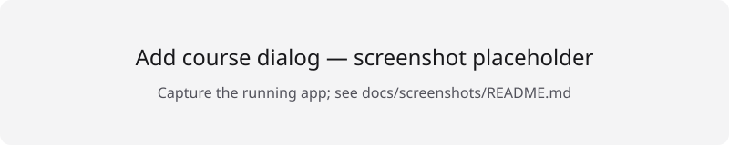

# Courseshelf

A personal Ubuntu desktop app for following local video courses. Videos stay in
their original folders; Courseshelf stores your progress, notes and cover copies locally.

## Features

- Library with title search, status filters, sorting and a Continue card.
- Add courses from folders containing MP4, M4V and WebM videos.
- Sections derived from folders, natural lesson ordering and cached durations.
- Native video controls, keyboard shortcuts and fullscreen.
- After a lesson ends, a five-second countdown opens the next lesson. Cancel with the button or S.
- Saved playback positions, resume, manual completion and automatic completion.
- Plain-text per-lesson notes with autosave, plus all notes for a course.
- Edit titles/covers, rescan, relocate and remove courses without deleting videos.
- Light/dark appearance follows the system theme.

## Screenshots

These are labeled placeholders, not screenshots of the app. See
[capture instructions](docs/screenshots/README.md) to replace them with real images.




## Install on Ubuntu

Target: Ubuntu 24.04 with WebKitGTK 4.1. Download an existing release deb if one
has been provided, or build it locally using [the release guide](docs/release.md).
No automatic update or download service is configured.

Quit all running copies before installing or upgrading:

```sh
sudo apt install ./Courseshelf_0.2.0_amd64.deb
courseshelf
```

Adjust the path to the downloaded/built file. Apt installs the declared GTK/WebKit
and GStreamer dependencies. For a rebuilt package with the same version, add
`--reinstall`. Uninstall with `sudo apt remove courseshelf`; user data is retained.

**Linux renderer compatibility:** Courseshelf defaults
`WEBKIT_DISABLE_DMABUF_RENDERER=1` on Linux, before Tauri creates the webview.
This avoids the black/white seek frames observed on the affected development
machine, at the cost of WebKitGTK's faster DMABUF rendering path. Normal launches
need no flag.

Any existing environment value is preserved, including `0` or an empty value.
To opt out of the workaround for one launch and let WebKit choose its default path:

```sh
WEBKIT_DISABLE_DMABUF_RENDERER=0 courseshelf
```

Quit every other copy first (the app is single-instance). To restore the app's
default for one launch, use `env -u WEBKIT_DISABLE_DMABUF_RENDERER courseshelf`.
Nothing is changed in your shell profile or system environment. Non-Linux
platforms are unaffected.
See [release troubleshooting](docs/release.md#player-keyboard-and-fullscreen-checks).

## Windows test installer

An optional, manually triggered GitHub Actions workflow builds an unsigned x64
setup `.exe` on a Windows runner. No Rust/Visual Studio installation is needed on
your own Windows computer to test it. Download the artifact, extract it and run
the installer; WebView2 may require an internet download if not already installed.
Windows runtime behavior still needs verification before sharing with friends.
See [Windows build, installation and test steps](docs/windows.md).

## How it works

The native directory picker grants access to a selected folder. A strict Rust
walker canonicalizes the root, skips symlinks and hidden folders, and feeds a pure
TypeScript parser. Only MP4/M4V/WebM files become lessons. Sections are the parent
folder paths, not database rows.

Lessons are matched by their path relative to the course root. Rescans mark
disappeared lessons as missing and preserve their progress and notes. An unreadable
root, or an empty scan of an existing course, aborts without wiping lesson data.
Relocating a course keeps matching relative paths.

Videos are served through a token-protected loopback server on a random port,
with byte-range seeking. They are not copied into the app or loaded via Tauri's
asset protocol. Cover images are copied into app data.

Playback positions are saved about every five seconds and flushed on pause,
navigation and close. Completion is manual or automatic at 90% while playing
(short lessons complete on ended); undo suppresses auto-completion for that visit.
Notes are plain text, autosaved after typing stops and flushed alongside progress.
Closing gives pending saves up to two seconds, then closes even if saving fails.

## Development

Prerequisites:

- Node **22.19.0** (`.nvmrc`) and pnpm **11.17.0** (`packageManager`).
- A current stable Rust toolchain with rustfmt and clippy.
- [Tauri 2 Linux prerequisites](https://v2.tauri.app/start/prerequisites/).
  On Ubuntu:

```sh
sudo apt install build-essential pkg-config libwebkit2gtk-4.1-dev libgtk-3-dev \
  libxdo-dev libssl-dev librsvg2-dev libayatana-appindicator3-dev patchelf \
  gstreamer1.0-libav gstreamer1.0-plugins-base gstreamer1.0-plugins-good
```

`gstreamer1.0-plugins-bad` is recommended for additional playback support.
Actual codec availability depends on the video files.

From the repository root (use `nvm use` first if you use nvm):

```sh
pnpm install --frozen-lockfile
pnpm tauri dev
```

Quit the installed app before dev: both use the same database and single-instance
identity. The Linux renderer default applies to dev builds too; to opt out, use
`WEBKIT_DISABLE_DMABUF_RENDERER=0 pnpm tauri dev`.

Quality gates, also run by [CI](.github/workflows/ci.yml):

```sh
pnpm check
pnpm check:rust
```

Other scripts: `pnpm typecheck`, `pnpm lint`, `pnpm lint:fix` (safe Biome fixes),
`pnpm format` (formatting only), and `pnpm test`.
CI checks pushes and pull requests; it does not publish or deploy releases.
The former `/dev/spike` screen has been removed.

## Tech stack

Tauri 2, Rust, React, TypeScript, React Router, Tailwind CSS v4, shadcn/ui
(Base UI), SQLite through tauri-plugin-sql, Biome and Vitest. Inter is bundled;
there are no remote fonts or required cloud services.

Frontend features live in `src/features`; SQL and numbered migrations in
`src/lib/db`; scanning and the loopback server in `src-tauri/src`.

## Data, backups and troubleshooting

Default Ubuntu locations (identifier remains `com.khaled.courseshelf`):

| Data | Location |
| --- | --- |
| Database, possible WAL/SHM | `~/.config/com.khaled.courseshelf/courseshelf.db` |
| Copied cover images | `~/.local/share/com.khaled.courseshelf/covers/` |
| Persisted folder grants | `~/.local/share/com.khaled.courseshelf/.persisted-scope` |

`XDG_CONFIG_HOME` and `XDG_DATA_HOME` override the base directories.
Database backups contain course paths, progress and notes, **not** videos,
covers or filesystem grants. The backup menu is intentionally hidden; backup
helpers remain in the code. Restore is manual.

- [Backup and restore instructions](docs/backup-and-restore.md)
- [Build, install and release verification](docs/release.md)
- [Daily-use bug notes](docs/bugs.md)
